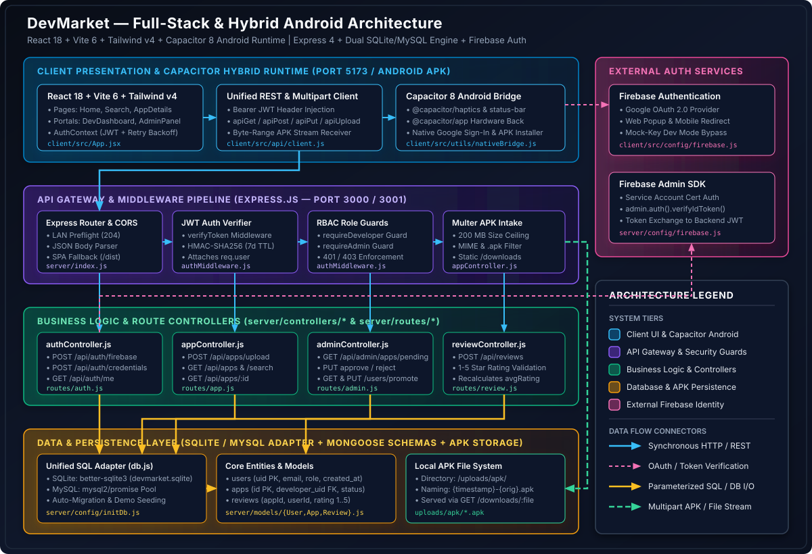

# DevMarket System Architecture

This document provides an exhaustive technical reference for the **DevMarket** platform—covering architectural design patterns, technology stack justifications, directory structure, component responsibilities, database schemas, and step-by-step runtime data flows.

> **Note**: This document is mirrored at [`docs/ARCHITECTURE.md`](docs/ARCHITECTURE.md).

---

## 1. High-Level Architecture Diagram



### Architecture Legend & Connector Key

| Visual Element | Color / Pattern | Architectural Meaning |
| :--- | :--- | :--- |
| **Client UI & Capacitor Android** | Sky Blue (`#0284C7` / `#38BDF8`) | React 18 SPA, Vite 6 bundler, Tailwind CSS v4, Unified API Client, and Capacitor 8 Native Android runtime |
| **API Gateway & Security Guards** | Violet (`#7C3AED` / `#8B5CF6`) | Express.js router, LAN CORS preflight handler, JWT `verifyToken` middleware, RBAC guards, and Multer binary filter |
| **Business Logic & Controllers** | Emerald (`#10B981` / `#6EE7B7`) | Domain controllers (`authController`, `appController`, `adminController`, `reviewController`) |
| **Database & APK Persistence** | Amber / Green (`#F59E0B` / `#34D399`) | Unified SQLite (`better-sqlite3`) & MySQL (`mysql2`) query adapter, Mongoose schema models, and local `/uploads/apk` storage |
| **External Firebase Identity** | Pink (`#EC4899` / `#F472B6`) | Firebase Client Authentication (Google OAuth 2.0) and server-side Firebase Admin SDK |
| **Solid Blue Arrow (`───►`)** | `#38BDF8` | Synchronous HTTP/REST JSON request/response (`apiGet`, `apiPost`, `apiPut`, `apiDelete`) |
| **Dashed Pink Arrow (`- - ►`)** | `#F472B6` | OAuth 2.0 Redirect/Popup & Firebase ID Token verification (`verifyIdToken`) |
| **Solid Amber Arrow (`───►`)** | `#FBBF24` | Parameterized SQL query execution (`query(sql, params)`) against SQLite or MySQL |
| **Dashed Green Arrow (`- - ►`)** | `#34D399` | Multipart `form-data` binary upload (`upload.single('apk')`) and byte-range attachment streaming (`GET /downloads/:filename`) |

---

## 2. Core Architectural Design Patterns

### 2.1 Hybrid Web & Native Execution (Single Codebase, Dual Target)
DevMarket compiles a single React 18 + Tailwind CSS v4 frontend (`client/src/`) into two distinct deployment targets:
- **Desktop & Mobile Web Browser**: Served via Vite (`localhost:5173`) during development or statically from `client/dist/` by Express in production. On desktop viewports, the layout renders inside an interactive flagship smartphone simulator frame with live clock and status indicators.
- **Native Android Application (`.apk`)**: Wrapped by **Capacitor 8** (`@capacitor/android`), executing inside a hardware-accelerated Chromium WebView with direct JavaScript-to-Java native bridge bindings for Haptics (`@capacitor/haptics`), Status Bar styling (`@capacitor/status-bar`), Hardware Back Button interception (`@capacitor/app`), and Native Google Sign-In (`@capawesome/capacitor-google-sign-in`).

### 2.2 Token-Exchange Authentication & Dual-Mode Identity
Rather than coupling every API endpoint directly to Firebase network calls, DevMarket implements a **Token-Exchange Gateway Pattern**:
1. **Federated User Login (`POST /api/auth/firebase`)**: End users authenticate via Firebase Google OAuth (or `mock-token-<email>` in offline development mode). The backend verifies the Firebase ID token once via `firebase-admin` (or parses the mock token), upserts the user record in the local database, applies deterministic role elevation rules (`DEMO_ADMIN_EMAIL` -> `administrator`, `developer@devmarket.lan` -> `developer`), and issues a self-contained, 7-day **HMAC-SHA256 Backend JWT**.
2. **Direct Credential Login (`POST /api/auth/credentials`)**: Administrators and developers can authenticate directly using server-configured credentials (`ADMIN_USERNAME`/`ADMIN_PASSWORD` or `DEVELOPER_USERNAME`/`DEVELOPER_PASSWORD`), receiving the same standardized 7-day Backend JWT format (`{ uid, email, role }`).
3. **Stateless Route Verification (`verifyToken`)**: All subsequent protected API calls require only local cryptographic signature verification (`jwt.verify(token, process.env.JWT_SECRET)`), eliminating external network latency on protected requests.

### 2.3 Unified Dual-Dialect Database Adapter (`server/config/db.js`)
To support both zero-configuration local development/testing and multi-user relational deployments, `server/config/db.js` exports a single `query(sql, params)` promise interface:
- When `DB_TYPE=sqlite`, synchronous `better-sqlite3` prepared statements (`stmt.all` for `SELECT`/`PRAGMA`, `stmt.run` for mutations) are wrapped in a standard `Promise` operating on `./devmarket.sqlite`.
- When `DB_TYPE=mysql` (default if unspecified), queries delegate to a `mysql2/promise` connection pool (`connectionLimit: 10`) with startup connectivity verification.
- Result normalization helpers (`selectRows`, `insertId`, `affectedRows`) in controllers transparently bridge structural differences between `better-sqlite3` (`lastInsertRowid`, `changes`, flat row arrays) and `mysql2` (`insertId`, `affectedRows`, `[rows, fields]` tuples).

### 2.4 Staged Binary Moderation Pipeline
Uploaded `.apk` packages never appear immediately in the public catalog. Every binary uploaded via `POST /api/apps/upload` is written to `uploads/apk/<timestamp>-<originalname>` with a database status of `'pending'`. Public discovery routes (`GET /api/apps`, `GET /api/apps/search`, `GET /api/apps/:id`) strictly filter by `WHERE status = 'approved'`, isolating unverified binaries until an administrator explicitly transitions the record via `PUT /api/admin/apps/:id/approve` or `PUT /api/admin/apps/:id/reject`.

---

## 3. Technology Stack & Justifications

| Layer | Technology | Version | Justification |
| :--- | :--- | :--- | :--- |
| **Frontend Framework** | React + React Router | `18.3.1` / `7.13.0` | Declarative component tree with nested client-side routing (`createBrowserRouter`) and context-driven auth state |
| **Build Tool & Styling** | Vite + Tailwind CSS | `6.3.5` / `4.1.12` | Instant HMR, native ES module bundling, and utility-first dark/light theming (`next-themes` + `motion` animations) |
| **Mobile Native Runtime** | Capacitor Android | `8.3.0` (`CLI 7.6.1`) | Bridges web views to native Android SDK 36 APIs (haptics, status bar, hardware back button, native OAuth) |
| **Backend Runtime & HTTP** | Node.js + Express | `20+` / `4.18.2` | Lightweight middleware pipeline, streaming static attachment delivery (`/downloads`), and SPA fallback routing |
| **Multipart File Engine** | Multer | `2.1.1` | Disk storage streaming with strict 200 MB file size ceiling and MIME/extension filtering |
| **Primary SQL Persistence** | Better-SQLite3 / MySQL2 | `13.0.3` / `3.9.2` | High-speed embedded C++ SQLite engine for zero-setup local dev & property testing; MySQL 8 pool for production |
| **Document Schema Models** | Mongoose | `7.0.3` | Provides strongly-typed document schemas (`User`, `App`, `Review`) used by the review subsystem (`reviewController.js`) |
| **Authentication & Security** | Firebase Admin + JWT | `12.0.0` / `9.0.0` | Cryptographic Google ID token verification paired with stateless HMAC-SHA256 bearer sessions |
| **Automated Testing** | Jest + Vitest + Fast-Check | `29.7` / `4.1` / `3.19` | Property-based testing (`fast-check`) over randomized inputs alongside Supertest HTTP assertions and JSDOM UI tests |

---

## 4. Complete Repository Directory Layout

```text
Devmarket/
├── .env.example                        # Server & LAN environment variable template
├── package.json                        # Root scripts, backend dependencies, and Jest test runner
├── setup.js                            # Automated project bootstrapper (.env, uploads/apk, npm install)
├── docs/
│   ├── ARCHITECTURE.md                 # Primary system architecture reference
│   ├── API.md                          # Complete REST API specification
│   └── assets/
│       └── system-overview.svg         # Standalone vector system architecture diagram
├── client/                             # React 18 + Vite 6 + Capacitor 8 Frontend Workspace
│   ├── .env.example                    # Frontend Vite & Firebase environment template
│   ├── capacitor.config.json           # Production Capacitor Android configuration (bundled dist)
│   ├── capacitor.config.dev.json       # Development Capacitor configuration (LAN live-reload)
│   ├── vite.config.js                  # Vite bundler & /api -> localhost:3000 proxy config
│   ├── vitest.config.js                # Vitest JSDOM test runner configuration
│   ├── android/                        # Native Android Gradle project (AGP 8.9.1, SDK 36)
│   │   └── app/src/main/               # AndroidManifest.xml, MainActivity, and public web assets
│   └── src/
│       ├── main.jsx                    # React DOM root mount
│       ├── App.jsx                     # BrowserRouter route definitions & provider hierarchy
│       ├── api/
│       │   └── client.js               # Fetch wrapper (apiGet, apiPost, apiPut, apiDelete, apiUpload)
│       ├── config/
│       │   └── firebase.js             # Firebase client app & GoogleAuthProvider initialization
│       ├── context/
│       │   └── AuthContext.jsx         # Multi-mode session state, exponential backoff retry, OAuth handlers
│       ├── components/
│       │   ├── Layout.jsx              # Adaptive mobile shell / desktop simulator frame & navigation drawer
│       │   ├── BottomNav.jsx           # Tactile glass bottom tab bar with haptic feedback
│       │   └── DownloadManager.jsx     # Active APK transmission tracker
│       ├── pages/
│       │   ├── HomePage.jsx            # Featured & trending approved apps catalog
│       │   ├── SearchPage.jsx          # Real-time keyword & category filtering
│       │   ├── AppDetailsPage.jsx      # App metadata, screenshot carousel, rating, and APK download trigger
│       │   ├── SharePage.jsx           # Deep-link & QR sharing view for individual apps
│       │   ├── DownloadsPage.jsx       # Device storage meter & downloaded package manager
│       │   ├── LibraryPage.jsx         # Installed applications & cloud library insights
│       │   ├── DevDashboard.jsx        # Developer portal for multipart .apk upload & metadata submission
│       │   ├── AdminPanel.jsx          # Administrator moderation queue & user role promotion console
│       │   ├── Login.jsx               # Role-tabbed login (Google OAuth, Credentials, 1-Tap Mock Accounts)
│       │   ├── Profile.jsx             # Authenticated user profile & role badge view
│       │   ├── Settings.jsx            # Application preferences root
│       │   ├── Security.jsx            # Security settings view
│       │   ├── Notifications.jsx       # Notification preferences view
│       │   └── Privacy.jsx             # Privacy controls view
│       ├── utils/
│       │   └── nativeBridge.js         # Capacitor StatusBar, Haptics, and Hardware Back Button bindings
│       ├── styles/
│       │   ├── index.css               # Tailwind CSS v4 imports & safe-area-inset utilities
│       │   └── theme.css               # Dark/light editorial design tokens
│       └── test/                       # Frontend Vitest & fast-check property test suites
├── server/                             # Express.js Backend Workspace
│   ├── index.js                        # Server entrypoint, CORS, static /downloads, route mounting
│   ├── jest.config.js                  # Backend Jest configuration
│   ├── config/
│   │   ├── db.js                       # Unified SQLite (better-sqlite3) / MySQL (mysql2) query adapter
│   │   ├── firebase.js                 # Firebase Admin SDK service account initializer
│   │   └── initDb.js                   # Schema DDL, automatic column migration, and demo data seeder
│   ├── middleware/
│   │   └── authMiddleware.js           # verifyToken, requireAdmin, and requireDeveloper guards
│   ├── controllers/
│   │   ├── authController.js           # firebaseAuth, credentialAuth, and getMe handlers
│   │   ├── appController.js            # Multer uploadApp, getApps, getAppsSearch, and getApp handlers
│   │   ├── adminController.js          # getPendingApps, approveApp, rejectApp, getUsers, promoteUser
│   │   └── reviewController.js         # submitReview handler & averageRating recalculation
│   ├── routes/
│   │   ├── auth.js                     # /api/auth/* route definitions
│   │   ├── app.js                      # /api/apps/* route definitions
│   │   ├── admin.js                    # /api/admin/* route definitions
│   │   └── review.js                   # /api/reviews/* route definitions
│   ├── models/
│   │   ├── User.js                     # Mongoose User schema definition
│   │   ├── App.js                      # Mongoose App schema definition with text index
│   │   └── Review.js                   # Mongoose Review schema definition (rating 1..5)
│   └── __tests__/                      # 8 backend Jest + Supertest + fast-check test suites
└── uploads/
    └── apk/                            # Local filesystem destination for uploaded and seeded .apk binaries
```

---

## 5. Detailed Component Breakdown

### 5.1 Client Presentation Layer (`client/src/`)
- **Router Hierarchy (`client/src/App.jsx`)**: Wraps the application in `<AuthProvider>` and `<ThemeProvider attribute="class" defaultTheme="dark">`. Defines `/login` as a standalone route and mounts all primary views (`HomePage`, `SearchPage`, `AppDetailsPage`, `SharePage`, `DownloadsPage`, `LibraryPage`, `DevDashboard`, `AdminPanel`, `Profile`, `Settings`, `Security`, `Notifications`, `Privacy`) as nested children under `<Layout />`.
- **Authentication Context (`client/src/context/AuthContext.jsx`)**:
  - Persists `{ token, user }` in `localStorage` under the key `devmarket_auth`.
  - Implements `retryOperation(operation, retries = 3)` with exponential backoff (`1000ms * 2^attempt`) to handle transient mobile network drops.
  - Supports three distinct sign-in flows:
    1. **Mock Mode (`VITE_FIREBASE_API_KEY === 'mock-key'`)**: Sends `mock-token-<email>` to `POST /api/auth/firebase` for instant offline testing.
    2. **Native Android Google Sign-In (`Capacitor.isNativePlatform()`)**: Uses `@capawesome/capacitor-google-sign-in` to obtain a native Google ID token, exchanges it for a Firebase credential via `signInWithCredential`, and posts the Firebase ID token to `/api/auth/firebase`.
    3. **Web Browser Google Popup (`signInWithPopup`) & Credential Login (`loginWithCredentials`)**: Authenticates via Google OAuth popup for standard users or posts `{ username, password, role }` to `POST /api/auth/credentials` for administrators and developers.
- **Unified API Client (`client/src/api/client.js`)**:
  - Reads `import.meta.env.VITE_API_BASE_URL || '/api'`.
  - Automatically injects `Authorization: Bearer <token>` from `localStorage.getItem('devmarket_auth')` on every JSON request (`apiGet`, `apiPost`, `apiPut`, `apiDelete`) and multipart upload (`apiUpload`).

### 5.2 Capacitor Native Bridge (`client/src/utils/nativeBridge.js`)
- **`updateStatusBar(isDark)`**: Synchronizes the native Android system status bar with the active UI theme (`#0e0e0e` in dark mode, `#ffffff` in light mode) and disables webview overlay (`StatusBar.setOverlaysWebView({ overlay: false })`).
- **`hapticLight()`, `hapticMedium()`, `hapticSuccess()`**: Triggers native `@capacitor/haptics` impact/notification patterns on physical devices and falls back to `navigator.vibrate()` on supported mobile browsers.
- **`setupBackButtonListener(navigate, isSidebarOpen, closeSidebar)`**: Listens to the `@capacitor/app` `backButton` event—closing the navigation drawer if open, navigating backward in history (`navigate(-1)`) on sub-pages, or cleanly exiting the app (`App.exitApp()`) when on the root home screen (`/`).

### 5.3 Express Server & Middleware (`server/index.js`, `server/middleware/authMiddleware.js`)
- **CORS & Preflight (`server/index.js`)**: Configures `cors` with `origin: process.env.CORS_ORIGIN || '*'`, `allowedHeaders: ['Authorization', 'Content-Type', 'X-Requested-With']`, and `optionsSuccessStatus: 204` across all routes and `OPTIONS *` preflights.
- **Static APK Streaming (`/downloads`)**: Mounts `express.static('uploads/apk/')` at `/downloads` with `Content-Disposition: attachment` and `fallthrough: false`, ensuring missing files immediately return a `404` status rather than falling through to the SPA `index.html` handler.
- **Authentication & Authorization Guards (`server/middleware/authMiddleware.js`)**:
  - `verifyToken`: Extracts the `Bearer <token>` header, verifies it against `process.env.JWT_SECRET`, and populates `req.user = { uid, email, role }`. Returns `401 Unauthorized` if missing, malformed, or expired.
  - `requireDeveloper`: Permits requests where `req.user.role === 'developer'` or `req.user.role === 'administrator'`; returns `403 Forbidden` otherwise.
  - `requireAdmin`: Permits requests only where `req.user.role === 'administrator'`; returns `403 Forbidden` for all other roles.

### 5.4 Data Layer & Schema Definitions (`server/config/initDb.js`, `server/models/`)

#### Relational SQL Tables (`users` & `apps` in SQLite / MySQL)

**Table: `users`**
| Column | SQLite Type | MySQL Type | Constraints | Description |
| :--- | :--- | :--- | :--- | :--- |
| `uid` | `VARCHAR(128)` | `VARCHAR(128)` | `PRIMARY KEY` | Unique user identifier (Firebase UID, `admin-<user>`, or `mock-uid-*`) |
| `email` | `VARCHAR(255)` | `VARCHAR(255)` | `NOT NULL UNIQUE` | User email address |
| `role` | `TEXT CHECK(...)` | `ENUM(...)` | `NOT NULL DEFAULT 'user'` | One of `'user'`, `'developer'`, `'administrator'` |
| `created_at` | `TIMESTAMP` | `TIMESTAMP` | `NOT NULL DEFAULT CURRENT_TIMESTAMP` | Account creation timestamp |

**Table: `apps`**
| Column | SQLite Type | MySQL Type | Constraints | Description |
| :--- | :--- | :--- | :--- | :--- |
| `id` | `INTEGER` | `INT` | `PRIMARY KEY AUTOINCREMENT` | Unique numeric application ID (aliased as `_id` in JSON responses) |
| `developer_uid` | `VARCHAR(128)` | `VARCHAR(128)` | `NOT NULL FOREIGN KEY -> users(uid)` | UID of the submitting developer |
| `name` | `VARCHAR(255)` | `VARCHAR(255)` | `NOT NULL` | Display title of the Android application |
| `description` | `TEXT` | `TEXT` | `NOT NULL DEFAULT ''` | Full text description of the app |
| `category` | `VARCHAR(100)` | `VARCHAR(100)` | `NOT NULL DEFAULT 'Other'` | Marketplace category (e.g., `Productivity`, `Games`, `Security`) |
| `version` | `VARCHAR(50)` | `VARCHAR(50)` | `NOT NULL DEFAULT '1.0'` | Semantic version string of the package |
| `filename` | `VARCHAR(255)` | `VARCHAR(255)` | `NOT NULL` | Stored filename inside `uploads/apk/` (`<timestamp>-<originalname>`) |
| `screenshots` | `TEXT` | `TEXT` | `NULL` | JSON-serialized array of screenshot URLs |
| `average_rating` | `REAL` | `FLOAT` | `DEFAULT 4.8` | Aggregate star rating (aliased as `averageRating` in JSON responses) |
| `status` | `TEXT CHECK(...)` | `ENUM(...)` | `NOT NULL DEFAULT 'pending'` | Moderation state: `'pending'`, `'approved'`, or `'rejected'` |
| `uploaded_at` | `TIMESTAMP` | `TIMESTAMP` | `NOT NULL DEFAULT CURRENT_TIMESTAMP` | Submission timestamp |

#### Mongoose Document Schemas (`server/models/`)
In addition to the SQL tables, `server/models/` defines three Mongoose models used by the review subsystem (`server/controllers/reviewController.js`):
- **`User` (`server/models/User.js`)**: `{ name: String, contact: String (unique), password: String, role: ['user', 'developer', 'administrator'], createdAt: Date }`
- **`App` (`server/models/App.js`)**: `{ name: String, description: String, category: String, developerId: ObjectId(ref: 'User'), apkUrl: String, screenshots: [String], status: ['Pending', 'Live', 'Rejected'], averageRating: Number, createdAt: Date }` with a compound text index on `{ name: 'text', category: 'text' }`.
- **`Review` (`server/models/Review.js`)**: `{ appId: ObjectId(ref: 'App'), userId: ObjectId(ref: 'User'), rating: Number (min: 1, max: 5), comment: String, createdAt: Date }`.

---

## 6. End-to-End Runtime Data Flows

### 6.1 Authentication & Role Promotion Flow

```text
+-------------------+      +------------------------+      +-------------------------+      +--------------------+
|   Client / App    |      |   Firebase Auth /      |      |    Express Backend      |      |   SQLite / MySQL   |
|  (AuthContext)    |      |   Admin SDK            |      |   (authController.js)   |      |  (users table)     |
+---------+---------+      +-----------+------------+      +------------+------------+      +---------+----------+
          |                            |                                |                             |
          | 1. Google Sign-In          |                                |                             |
          |--------------------------->|                                |                             |
          |<---------------------------|                                |                             |
          | 2. Firebase idToken        |                                |                             |
          |                            |                                |                             |
          | 3. POST /api/auth/firebase { idToken }                      |                             |
          |------------------------------------------------------------>|                             |
          |                            |                                |                             |
          |                            | 4. verifyIdToken(idToken)      |                             |
          |                            |<-------------------------------|                             |
          |                            |------------------------------->|                             |
          |                            |    Decoded { uid, email }      |                             |
          |                            |                                | 5. INSERT OR IGNORE user    |
          |                            |                                |---------------------------->|
          |                            |                                | 6. Check DEMO_ADMIN_EMAIL   |
          |                            |                                |    & fetch current role     |
          |                            |                                |<----------------------------|
          | 7. 200 OK { success: true, token (7d JWT), user }           |                             |
          |<------------------------------------------------------------|                             |
          |                            |                                |                             |
          | 8. Admin calls PUT /api/admin/users/:uid/promote            |                             |
          |    (Authorization: Bearer <admin_jwt>)                      |                             |
          |------------------------------------------------------------>|                             |
          |                            |                                | 9. verifyToken +            |
          |                            |                                |    requireAdmin             |
          |                            |                                | 10. UPDATE users SET        |
          |                            |                                |     role = 'developer'      |
          |                            |                                |---------------------------->|
          | 11. 200 OK { success: true }                                |                             |
          |<------------------------------------------------------------|                             |
```

**Step-by-Step Execution**:
1. The user authenticates on the client via Google OAuth (`signInWithPopup` on web or `GoogleSignIn.signIn()` on Android) or selects a test account in `mock-key` mode.
2. `AuthContext.jsx` invokes `POST /api/auth/firebase` with `{ idToken }`.
3. `authController.firebaseAuth` verifies the token via `admin.auth().verifyIdToken(idToken)` (or parses `mock-token-<email>`).
4. The user is upserted into `users` with a default role of `'user'`. If `email === process.env.DEMO_ADMIN_EMAIL`, their role is elevated to `'administrator'`; if `email === 'developer@devmarket.lan'`, their role is set to `'developer'`.
5. The server signs a 7-day JWT (`jwt.sign({ uid, email, role }, process.env.JWT_SECRET, { expiresIn: '7d' })`) and returns `{ success: true, token, user }`.
6. When an administrator promotes a standard user in `AdminPanel.jsx`, the client sends `PUT /api/admin/users/:uid/promote`. After `verifyToken` and `requireAdmin` pass, `adminController.promoteUser` updates `role = 'developer'` in the `users` table.

---

### 6.2 APK Upload & Admin Moderation Flow

```text
+-------------------+      +------------------------+      +-------------------------+      +--------------------+
|  DevDashboard /   |      |   Multer Middleware    |      |  appController /        |      |  SQLite / MySQL &  |
|  AdminPanel       |      |   (200MB & APK Filter) |      |  adminController        |      |  /uploads/apk/     |
+---------+---------+      +-----------+------------+      +------------+------------+      +---------+----------+
          |                            |                                |                             |
          | 1. POST /api/apps/upload (multipart/form-data)              |                             |
          |    Headers: Authorization: Bearer <dev_jwt>                 |                             |
          |    Fields: apk (file), name, description, category, version |                             |
          |--------------------------->|                                |                             |
          |                            | 2. Validate MIME / .apk ext    |                             |
          |                            |    & size <= 200 MB            |                             |
          |                            |------------------------------->|                             |
          |                            |    Write to uploads/apk/       |---------------------------->|
          |                            |    {timestamp}-{orig}.apk      |                             |
          |                            |                                | 3. INSERT INTO apps         |
          |                            |                                |    (status = 'pending')     |
          |                            |                                |---------------------------->|
          | 4. 201 Created { success: true, app: { id, status: 'pending' } }                          |
          |<------------------------------------------------------------|                             |
          |                            |                                |                             |
          | 5. Admin calls GET /api/admin/apps/pending                  |                             |
          |------------------------------------------------------------>| 6. SELECT pending apps      |
          |                            |                                |    JOIN users ON uid        |
          |                            |                                |<--------------------------->|
          | 7. 200 OK { success: true, apps: [...] }                    |                             |
          |<------------------------------------------------------------|                             |
          |                            |                                |                             |
          | 8. Admin calls PUT /api/admin/apps/:id/approve              |                             |
          |------------------------------------------------------------>| 9. UPDATE apps SET          |
          |                            |                                |    status = 'approved'      |
          |                            |                                |---------------------------->|
          | 10. 200 OK { success: true }                                |                             |
          |<------------------------------------------------------------|                             |
```

**Step-by-Step Execution**:
1. A developer opens `DevDashboard.jsx`, selects a `.apk` binary, fills out metadata (`name`, `description`, `category`, `version`), and submits the form via `apiUpload('/apps/upload', formData)`.
2. `verifyToken` and `requireDeveloper` validate that the caller holds `'developer'` or `'administrator'` privileges.
3. Multer checks that `file.mimetype === 'application/vnd.android.package-archive' || file.originalname.endsWith('.apk')` and enforces the `200 * 1024 * 1024` byte limit. Violations return `400 Bad Request` (`Only APK files are allowed`) or `413 Payload Too Large` (`File too large`).
4. Valid binaries are streamed to `uploads/apk/<Date.now()>-<originalname>` and recorded in the `apps` table with `status = 'pending'`.
5. An administrator opens `AdminPanel.jsx`, which fetches `GET /api/admin/apps/pending` and triggers `PUT /api/admin/apps/:id/approve` (or `/reject`). Once approved, the app immediately becomes visible in `GET /api/apps` and `GET /api/apps/search`.

---

### 6.3 APK Download & Native Installation Flow

```text
+-------------------+      +------------------------+      +-------------------------+      +--------------------+
|  User Device      |      |   Express Backend      |      |  Static /downloads      |      |  Capacitor Android |
|  (AppDetailsPage) |      |   (appController.js)   |      |  (uploads/apk/)         |      |  Package Installer |
+---------+---------+      +-----------+------------+      +------------+------------+      +---------+----------+
          |                            |                                |                             |
          | 1. GET /api/apps/:id       |                                |                             |
          |--------------------------->|                                |                             |
          |                            | 2. Query approved app & build  |                             |
          |                            |    downloadUrl:                |                             |
          |                            |    http://<LAN_IP>:<PORT>/     |                             |
          |                            |    downloads/<filename>        |                             |
          | 3. 200 OK { success: true, app }                            |                             |
          |<---------------------------|                                |                             |
          |                            |                                |                             |
          | 4. User taps "Download / Install APK"                       |                             |
          |    Triggers hapticMedium() & GET /downloads/<filename>      |                             |
          |------------------------------------------------------------>|                             |
          |                            |                                | 5. Stream binary with       |
          |                            |                                |    Content-Disposition:     |
          |                            |                                |    attachment               |
          |<------------------------------------------------------------|                             |
          |                            |                                |                             |
          | 6. Trigger hapticSuccess() & hand off .apk to Android OS    |                             |
          |------------------------------------------------------------------------------------------>|
          |                            |                                |   REQUEST_INSTALL_PACKAGES  |
```

**Step-by-Step Execution**:
1. The client fetches catalog or app detail metadata via `GET /api/apps` or `GET /api/apps/:id`.
2. `formatApp(row)` in `appController.js` dynamically constructs `downloadUrl: http://${lanIp}:${port}/downloads/${row.filename}` using `process.env.LAN_IP` and `process.env.PORT`.
3. When the user initiates a download, `nativeBridge.js` fires tactile haptic feedback (`hapticMedium()`) and requests `/downloads/:filename`.
4. Express streams the `.apk` file from `uploads/apk/` with `Content-Disposition: attachment`. If the file does not exist on disk, `fallthrough: false` ensures Express returns `404 Not Found`.
5. On Android devices, the downloaded `.apk` is handed off to the system package installer (`android.permission.REQUEST_INSTALL_PACKAGES`) for on-device installation, concluding with `hapticSuccess()`.
