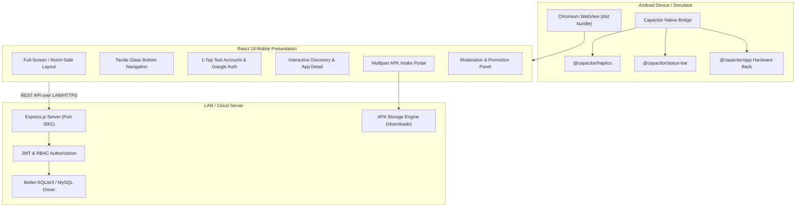

# DevMarket Mobile Platform 🚀

[](https://capacitorjs.com/)
[](https://react.dev/)
[](https://nodejs.org/)
[](https://expressjs.com/)
[](https://sqlite.org/)
[](https://vitejs.dev/)
[](https://tailwindcss.com/)

> **DevMarket** is a next-generation mobile app marketplace for developers. Built with a native **Capacitor Android runtime** and an editorial Spotify-inspired responsive design system, it provides high-speed package delivery, secure APK distribution, automated moderation, and cross-platform native hardware integration.

---

## 📱 Mobile Architecture & Data Flow



---

## ✨ Mobile-First Features

### 1. 📳 Native Hardware Integrations
- **Capacitor Android Bridge**: Packaged with `@capacitor/android`, `@capacitor/app`, `@capacitor/status-bar`, and `@capacitor/haptics`.
- **Haptic Tactile Feedback**: Micro-vibrations on bottom navigation tabs, buttons, APK installation steps, and modal toggles.
- **Dynamic Status Bar**: Harmonized with system dark/light modes (`#0e0e0e` dark / `#ffffff` light) with non-overlapping webview rendering.
- **Hardware Back Button Handling**: Intelligently handles Android device back gestures (closes drawers & modals, navigates history, prompts exit on home screen).
- **Notch & Cutout Safe Areas**: Incorporates `viewport-fit=cover` and CSS `env(safe-area-inset-top)` / `env(safe-area-inset-bottom)`.

### 2. 📱 Flagship Mobile UX & Desktop Simulator
- **Adaptive Screen Container**: 100% borderless edge-to-edge native view on mobile devices and physical Android hardware.
- **Desktop Simulator Preview**: On wide monitors, presents a flagship smartphone frame with live clock, status indicators, and bezel for testing.
- **Tactile Glass Bottom Nav**: Spotify-inspired emerald green active states (`#1ed760`), blur backdrop, and quick tab switching.
- **Instant Demo Auto-Fill**: One-tap credential auto-fill for developer and administrator logins on mobile touch keyboards.

### 3. 📦 APK Distribution & Package Ingestion
- **Direct Package Delivery**: Downloads delivered via byte-range static streaming with `Content-Disposition: attachment`.
- **Package Installation Permission**: Pre-configured `android.permission.REQUEST_INSTALL_PACKAGES` for seamless on-device APK installations.
- **Moderation Workflow**: Staged status pipeline (`pending` &rarr; `approved` / `rejected`) safeguarding users against unverified binaries.

---

## 👥 Roles & Test Accounts

| Persona | Role | Default Credentials / Method | Permissions |
| :--- | :--- | :--- | :--- |
| **User** | `user` | Google Sign-In (Mock or Real) | Explore marketplace, search apps, stream & download APKs, manage library |
| **Developer** | `developer` | Username: `developer` <br> Password: `dev123` | All User features + Upload and distribute new `.apk` packages up to 200MB |
| **Administrator**| `administrator`| Username: `admin` <br> Password: `admin123` | All features + Review pending apps, approve/reject packages, promote users |

> 💡 **Quick Login**: On the mobile sign-in page, tap the **"Auto-fill ⚡"** card to instantly populate credentials without typing.

---

## 🛠️ Quickstart Guide

### 1. Prerequisites
- **Node.js**: v18, v20, v22, or v24
- **npm**: v9+
- **Android Studio** (Optional, required for compiling native Android APKs)
- **Java Development Kit (JDK 17)** (For Gradle Android builds)

### 2. Installation & Setup
```bash
# 1. Clone the repository and install dependencies
npm run setup

# 2. Configure environment variables (pre-configured for SQLite zero-setup)
cp .env.example .env

# 3. Launch full-stack development environment (Server + Client)
npm run dev
```

The web application runs locally at `http://localhost:5173` (client) and `http://localhost:3001` (server).

---

## 🤖 Building the Android Mobile App

### Method 1: Sync and Open in Android Studio
```bash
# Build production web bundle and sync to Android project
npm run build
cd client
npx cap sync android

# Open Android Studio project directly
npx cap open android
```
Inside Android Studio:
1. Allow Gradle to sync.
2. Select **Build > Build Bundle(s) / APK(s) > Build APK(s)**.
3. The generated APK will be in:
   `client/android/app/build/outputs/apk/debug/app-debug.apk`

### Method 2: Build APK via Command Line
```bash
cd client/android
# Windows PowerShell
.\gradlew.bat assembleDebug

# Linux / macOS
./gradlew assembleDebug
```

### Method 3: Testing on a Physical Phone via Local Wi-Fi (LAN)
1. Find your machine's local IP address (e.g. `192.168.1.50` or `10.16.33.137` via `ipconfig` or `ifconfig`).
2. Update `.env` and `client/.env`:
   ```env
   LAN_IP=192.168.1.50
   PORT=3001
   VITE_API_BASE_URL=http://192.168.1.50:3001/api
   ```
3. Rebuild and sync:
   ```bash
   npm run build
   cd client && npx cap sync android
   ```
4. Install the newly built APK onto your phone. The mobile app will communicate directly with your backend over your local Wi-Fi.

---

## 🧪 Automated Testing Suite

The repository includes comprehensive backend unit/property-based tests (Jest + Supertest + Fast-Check) and frontend component integration tests (Vitest + React Testing Library).

```bash
# Run server test suite (50 tests passing)
npm test

# Run client frontend tests (7 tests passing)
npm run test:client

# Run all test suites
npm run test:all
```

---

## 📂 Project Structure

```
Devmarket/
├── client/                     # Frontend & Mobile Application
│   ├── android/                # Capacitor Android Native Project
│   │   ├── app/src/main/       # AndroidManifest.xml, native assets, Java activities
│   │   └── build.gradle        # Android build configuration
│   ├── src/
│   │   ├── api/client.js       # Unified fetch client with token injection
│   │   ├── components/         # Mobile components (Layout, BottomNav)
│   │   ├── context/            # AuthContext (multi-mode user session)
│   │   ├── pages/              # Mobile Views:
│   │   │   ├── HomePage.jsx    # Trending & featured apps
│   │   │   ├── SearchPage.jsx  # Instant search & category filters
│   │   │   ├── AppDetailsPage  # Interactive details & APK download
│   │   │   ├── DownloadsPage   # Storage meter & active transmission manager
│   │   │   ├── LibraryPage     # Installed tools & cloud insights
│   │   │   ├── DevDashboard    # APK upload & submission portal
│   │   │   ├── AdminPanel      # Moderation & user role administration
│   │   │   └── Login.jsx       # Mobile touch-friendly authentication
│   │   ├── utils/
│   │   │   └── nativeBridge.js # Capacitor Status Bar, Haptics, Back Button
│   │   └── styles/             # TailwindCSS & mobile safe-area styles
│   └── capacitor.config.json   # Capacitor mobile bridge configuration
├── server/                     # Backend API & Storage Engine
│   ├── config/                 # Database initialization & Firebase Admin SDK
│   ├── controllers/            # App, Admin, and Authentication controllers
│   ├── routes/                 # Express API routes (/api/apps, /api/auth, /api/admin)
│   ├── __tests__/              # Jest & Fast-Check property test suites
│   └── index.js                # Express entrypoint
├── uploads/apk/                # Local storage for distributed Android packages
└── package.json                # Root orchestration & scripts
```

---

## 🔒 Security & Verification

- **Binary Integrity**: Only verified `application/vnd.android.package-archive` payloads up to 200MB are permitted.
- **RBAC Enforcement**: Server-side verification for Developer (`/api/apps/upload`) and Admin (`/api/admin/*`) endpoints.
- **Zero-Trust Fallback**: Robust dual-tier authentication supporting Firebase tokens alongside HMAC-SHA256 JWT tokens.

---

## 📄 License
Distributed under the MIT License. See [LICENSE](LICENSE) for more details.
